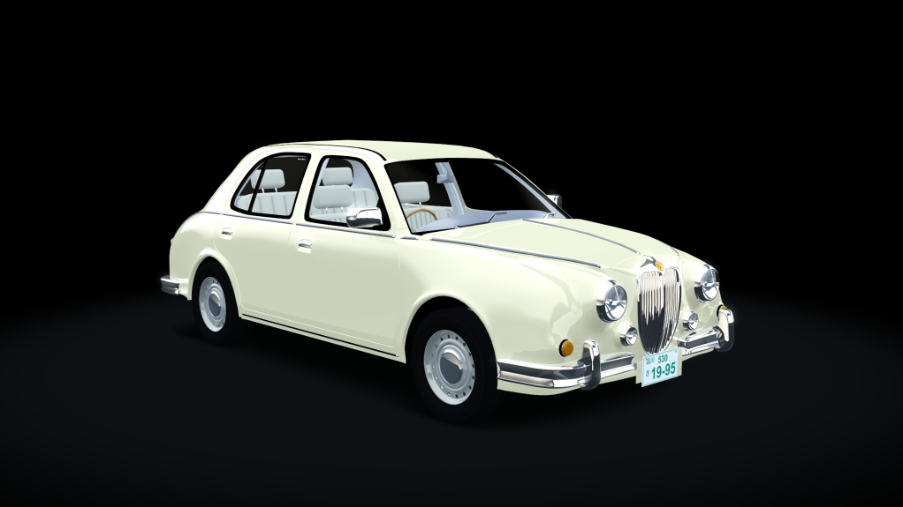
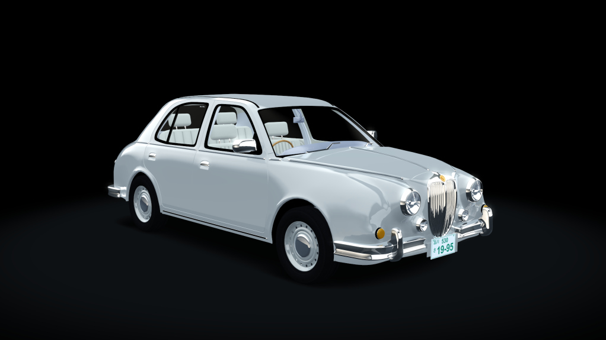
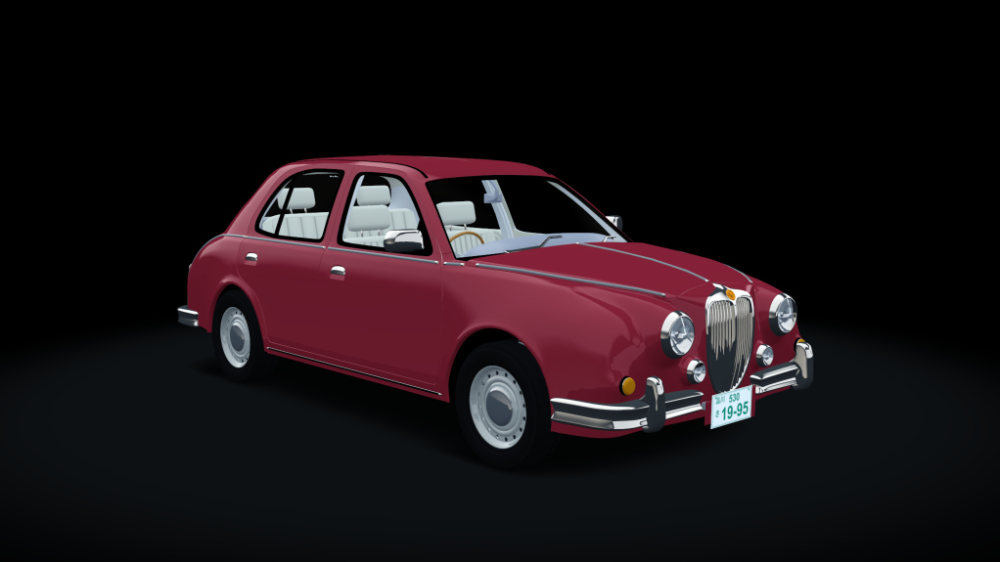
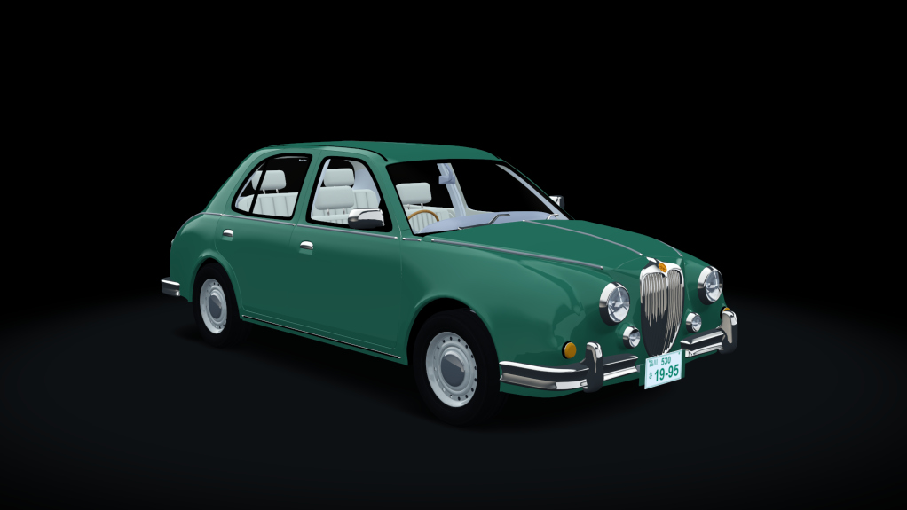
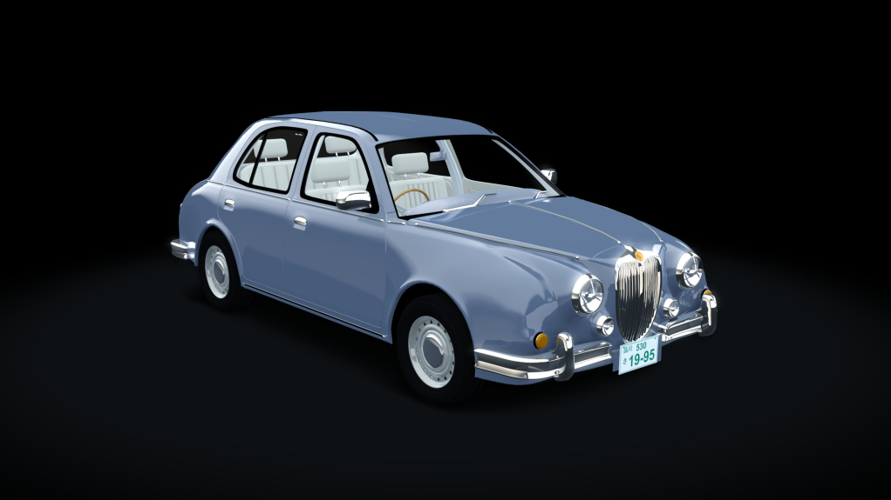
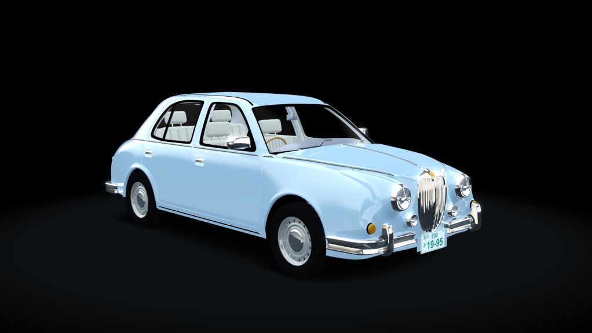
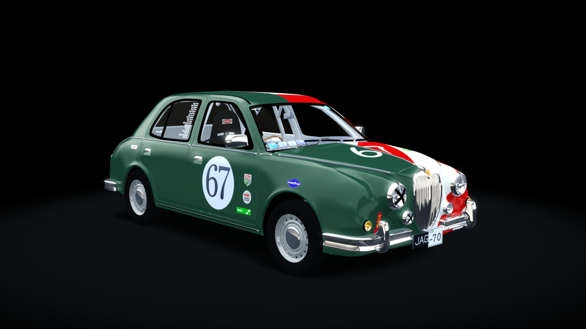
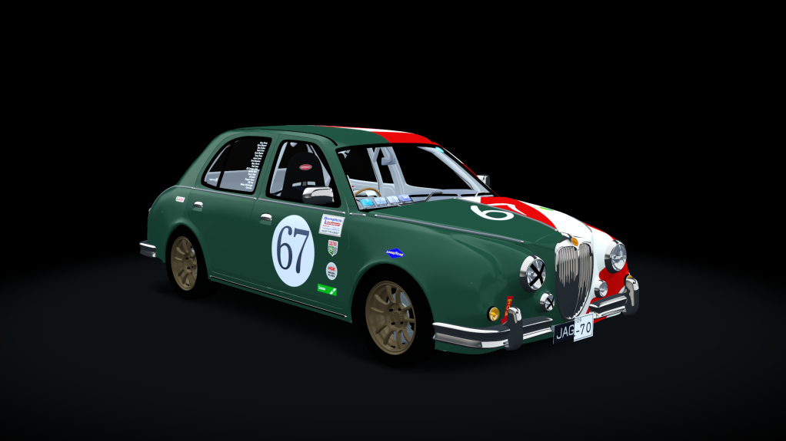

# Mitsuoka Viewt 1.0 for Assetto Corsa
The world's slowest race car, now available as a rolling roadblock in Assetto Corsa

## Previews

The road car, in its six factory colours:

<table>
<tr>
<td align="center"> Cream Ivory</td>
<td align="center"> Silver</td>
<td align="center"> Burgundy</td>
</tr>
<tr>
<td align="center"> Bottle Green</td>
<td align="center"> Slate Blue</td>
<td align="center"> Pale Blue</td>
</tr>
</table>

The three race cars, all in the Lost in Translation livery:

<table>
<tr>
<td align="center"> Lemons 2023</td>
<td align="center"> Lemons 2024</td>
<td align="center"> Lemons 2026</td>
</tr>
</table>

These are the Content Manager showroom previews, each skin's `preview.jpg`. They're remade in Content Manager whenever a car's kn5 changes (see Building), so commit them with the model.

## The cars

There are four cars in this repo. In Content Manager the three race cars are listed under the road car (their `ui_car.json` has `"parent": "mitsuoka_viewt"`). Each car has its own 3D model:

| Car folder | Name in game | Model | What it is |
| --- | --- | --- | --- |
| `mitsuoka_viewt` | Mitsuoka Viewt | `source/viewt_base.blend` | The road car, in six period colours (skins). Made from the 2023 model with the roll cage, race stickers, window decals and race kit removed, plain paint, 14" steel wheels with 185/60R14 road tyres and a factory interior (cream leather seats front and rear, burl wood dash and centre stack, carpet, pleated door cards and headliner). Physics as the 2023 car. |
| `mitsuoka_viewt_lemons_2023` | Mitsuoka Viewt Lemons 2023 | `source/viewt_2023.blend` | The road car's 14" steel wheels and 185/60R14 tyres; no Humphris Rallysport sticker; no rear-view screen on the dash |
| `mitsuoka_viewt_lemons_2024` | Mitsuoka Viewt Lemons 2024 | `source/viewt_2024.blend` | 195/50R15 tyres modelled at full width. Bilstein B4 dampers, HOL 60 mm lowering springs (front and rear) and front and rear sway bars (estimated figures). Holds the shared data (see below). |
| `mitsuoka_viewt_lemons_2026` | Mitsuoka Viewt Lemons 2026 | `source/viewt_2026.blend` | As 2024 (including the suspension upgrades), with the QG18 engine and 5-speed gearbox |

Some cars use their own copies of textures, named after the model: `source/texture/CarpaintExterior_*_2023.png` (2023, without the Humphris sticker) and `source/texture/*_base.png` (road car: plain paint and clean glass). The road car and the 2023 car share one wheel design (`steelwheel_`, `wheelcap_` and `roadtyre_base_color.png`): a 14" steel wheel (5.5J) with a 185/60R14 tyre, 0.576 m overall, the same overall radius as `RADIUS` in `tyres.ini`. The road car's interior has its own textures too: `burlwood_`, `carpet_`, `leather_cream_`, `doorcard_`, `headliner_`, `dashplastic_` and `dashstack_base_color.png` (the centre stack face is painted in one piece: vents, switches, radio, climate dials and A/C slider).

The road car's paint colours are skins in `mitsuoka_viewt/skins/`. Each one is a copy of `CarpaintExterior_Base_color_base.png` with the body painted in that colour, which replaces the texture of the same name in the kn5. The colours are Cream Ivory, Silver, Burgundy, Bottle Green, Slate Blue and Pale Blue, picked from photos of real first-generation (K11) Viewts, since Mitsuoka sold them in a wide custom palette and no official colour chart for the early cars turned up. The skin textures are deliberately warmer and darker than the colour they should look: the Content Manager showroom lights the paint with a strong blue ambient, so cream, silver and slate are pre-tinted to read correctly in the previews. The paint material (`CarpaintExterior` in `source/viewt_base.fbx.ini`) is `ksAmbient` 0.4, `ksDiffuse` 0.5, `ksSpecular` 0.55; higher values washed the colours out to near-white.

## Building

Run `build.bat`. It:

1. Exports each `source/viewt_<model>.blend` to `source/viewt_<model>.fbx`, if the .blend has changed since the last export
2. Checks each car's `viewt.kn5` is newer than its `source/viewt_<model>.fbx` and `source/viewt_<model>.fbx.ini`. If one isn't, it shows step-by-step instructions for re-saving it in ksEditor, then waits until you've done that so the new kn5 goes into the zip.
3. Checks every skin's `preview.jpg` in the road car and the 2024 car is newer than that car's `viewt.kn5`. If one isn't, it shows how to remake the previews in Content Manager (Skins tab > Update previews), then waits.
4. Copies the shared data from the 2024 car over the other cars (including its skins and previews)
5. Zips all four cars into `dist/mitsuoka_viewt_<version>.zip`, laid out as `content/cars/...` so it can be dropped onto Content Manager or extracted into the Assetto Corsa folder. The version comes from `mitsuoka_viewt/ui/ui_car.json`.

It needs:

- **Blender** - it uses the newest one in `%USERPROFILE%\Dropbox\programs`. To use a different one, set `BLENDER` to the path of `blender.exe`.
- **ksEditor** - it comes with Assetto Corsa (`assettocorsa\sdk\editor`). The build finds it through Steam to show you its path. If it can't, set `KSEDITOR` to the folder containing `ksEditor.exe`.

The export and ksEditor steps are skipped for any car whose inputs haven't changed, and the window stays open at the end so you can read the output.

## Making changes

**Make all physics and data changes to `mitsuoka_viewt_lemons_2024`, then run `build.bat`** to copy them across to the other cars. Don't edit the other car folders directly - the build mirrors the 2024 car over them, so anything changed only there will be overwritten or deleted.

The only exceptions are the files that are specific to each car, which the build leaves alone. Edit these in that car's folder directly:

- Road car and 2023: `data/suspensions.ini` (stock springs, dampers and sway bar; the 2024 file has the race upgrades, which 2026 shares)
- All cars: `viewt.kn5` (the model - see below) and `ui/ui_car.json` (name, description and specs)
- Race cars: `ui/upgrade.png`, the 64x64 icon Content Manager's car dropdown shows for a car listed under another. Each race car has its own, drawn in the style of Content Manager's built-in "STD" badge (a white ring round a small orange and red gauge, with the tier under it): 2023 is "STD", 2024 is "S1" and 2026 is "S2" (the 2023 and 2026 files are kept by the build, so only 2024's is the shared copy). The road car has none, so Content Manager gives it its own "STD" badge. Content Manager only reads these when it starts, so restart it after changing one
- Road car: `skins/` (the factory colours), and `data/mirrors.ini` and `data/digital_instruments.ini` (it has no rear-view camera screen or temperature display, so `mirrors.ini` leaves out `REAR_VIEW_DISPLAY` and there is no `digital_instruments.ini`; for the same reason it has no `extension/`, which only holds the screen's camera)
- 2023: `extension/` - there is none, as the 2023 car had no rear-view screen (the build leaves it out)
- 2026: `data/drivetrain.ini` and `data/power.lut` (engine and gearbox), and `x.tuned`

The build also makes these, so don't edit them in the other cars:

- `data/tyres.ini` - the 2024 car's file is the 195/50R15 Hankook Ventus R-S4 XL (`WIDTH` 0.195, `RADIUS` 0.288, `RIM_RADIUS` 0.1905 for the 15" rim), and 2026 gets it unchanged. The road car and 2023 get it with the tyre changed to the Vredestein Quatrac 5 185/60R14 (`NAME`, `WIDTH` 0.185 and `RIM_RADIUS` 0.1778 for the 14" rim; `RADIUS` stays 0.288, as 185/60R14 comes to 0.2888). Being an all-season tyre it also grips less: `DY0` 1.10 and `DX0` 1.11 (the Ventus has 1.3053 and 1.3142) and `FRICTION_LIMIT_ANGLE` 8.5 (7.52). All set in `build.bat`
- `sfx/GUIDs.txt` and `sfx/<car folder>.bank` - the sound bank is the same for all the cars, but has to be named after the car folder, so the build copies it under the right name and rewrites `GUIDs.txt` to match

If you add another file that should differ between the cars, add it to that car's `call :mirror` line in `build.bat`.

## The driver and the steering wheel

The model has no driver (the build leaves out the `DRIVER:` objects); AC supplies its own and positions it from three files: `driver_base_pos.knh` (its skeleton), `animations/steer.ksanim` (its arms follow the wheel through 100 frames, frame 50 being straight ahead) and `animations/shift.ksanim` (the left arm going to the gear lever). The skeleton's root bone, `DRIVER:DRIVER`, is what places the driver in the car, in the same coordinates as the kn5 (y up, z forward; the driver sits at negative x). The wheel is centred on x -0.329, y 0.8485, z 0.459 (the `STEER_HR` empty in the .blend), with a rim 0.169 m in outer radius.

To move the driver, add the same offset to that root bone's translation in the .knh and in every frame of `steer.ksanim` (a frame is 10 floats: rotation quaternion, position, scale). To bring the hands in towards the rim without moving the body, move the clavicle bones `DRIVER:RIG_Clave_L` and `_R` (their translation is constant, in chest coordinates) towards each other in all three files, including `shift.ksanim`, which otherwise only animates the left arm (its root is an identity placeholder, so leave that alone). The 2024 car's files are the ones to edit; the build copies them over the others. `DRIVEREYES` in `car.ini` is in the same coordinates, so move it with the head.

The wheel is raked about 20 degrees (its axis is about (0, -0.34, 0.94)), so judge the hands in the wheel's own plane, not in x and y: a vertical shift also moves the hands along the wheel's axis, in or out of the rim. Stock Kunos cars put the middle-finger knuckle bone (`HAND_Middle1`/`HAND_Middle4`) about 0.01 to 0.03 m outside the rim's outer radius in that plane, with the straight-ahead frame (50) as the reference. The Viewt's wheel is small (outer radius 0.168 m, against 0.18 to 0.2 for the stock ones) and the stock arms are wider than it, so the hands are brought in. As of 2026-10-18 the root is moved by (+0.010, +0.011, +0.015) and each clavicle by 0.021 towards the middle, which puts both knuckles about 0.01 m outside the rim and on its plane at frame 50 (before: 0.019 and 0.037 m outside, the right hand worst). A first attempt that moved the driver by (+0.017, +0.05) judged the wheel as vertical and made it worse. `DRIVEREYES` x went from -0.36 to -0.335.

## The rear-view screen

The dash screen is the `REAR_VIEW_DISPLAY` mesh, and it is left out of `data/mirrors.ini` on purpose: AC draws a mirror's picture over a mirror mesh, which would hide the camera. With Custom Shaders Patch (CSP), `extension/ext_config.ini` puts a real camera on the roof, where `CAMERA_5` in `data/cameras.ini` is, looking back (`[RENDERING_CAMERA_0]`, 150 degrees), squeezes its very wide picture through a fisheye pass (`[TEXTURE_PREPROCESSING_0]`) and `extension/rear_camera.lua` draws the result on the screen through a `[SCRIPTABLE_DISPLAY_0]`. Without CSP the screen is just black. For this to work the mesh's UVs cover the whole 0 to 1 square (they used to be a tiny patch of the shared texture), upright and unmirrored as seen from the driver's seat; the 2024 and 2026 models have this; the road car and the 2023 car (the real 2023 car had no screen) have none, so they have no `extension/` either. Positions in `ext_config.ini` are in the model's coordinates, which are the physics ones in `cameras.ini` minus `GRAPHICS_OFFSET` from `car.ini`, so move the camera by the same amount if `GRAPHICS_OFFSET` changes. The picture is a mirror image, like a backup camera's; set `MIRROR_IMAGE` to `false` at the top of the Lua script to turn that off.

## Updating the 3D models

Each car's model goes `source/viewt_<model>.blend` → `source/viewt_<model>.fbx` → `<car folder>/viewt.kn5`, where the model is `base`, `2023`, `2024` or `2026`. The three .blend files are separate, so a change that should apply to all of them has to be made in each one.

1. Edit `source/viewt_<model>.blend` in Blender and save it.
2. Run `build.bat`. It exports the .blend to `source/viewt_<model>.fbx`, leaving out the `DRIVER:` objects (AC supplies its own driver) and any hidden objects, and using the scale settings ksEditor expects.
3. The build then tells you to convert the FBX in ksEditor. Use a freshly opened ksEditor for each one, because File > Open FBX adds to whatever is already loaded and Save KN5 then saves the first model. File > Open FBX `source/viewt_<model>.fbx`, then File > Save KN5 > Car over `<car folder>/viewt.kn5`. Press a key when you're done, and it carries on to the next car and then makes the zip.

Material and per-object settings (shaders, textures, transparency, shadows, LODs) live in `source/viewt_<model>.fbx.ini`, not in the .blend - again one per car. To change them, open `source/viewt_<model>.fbx` in ksEditor (`assettocorsa\sdk\editor\ksEditor.exe`), which loads the .ini automatically. Make your changes, save them with File > Save Persistence over `source/viewt_<model>.fbx.ini`, then run `build.bat`. Commit the .ini along with the model.

The per-object sections in each .ini are keyed by the FBX file name (`[model_FBX: viewt_2023.fbx_...]`). If an FBX is ever renamed, rename those keys to match, or ksEditor will silently drop the per-object settings. Materials still load, because they're keyed by material name. To copy material changes from one car's .ini to another, copy the file and replace `viewt_<model>.fbx` with the other car's FBX name throughout.

## License

Released under the [MIT License](LICENSE). You can use, modify and redistribute this however you like, including as the starting point for your own mods, as long as you keep the copyright notice (credit to the original authors, Chris Rae and Tyler Stank) with it.
